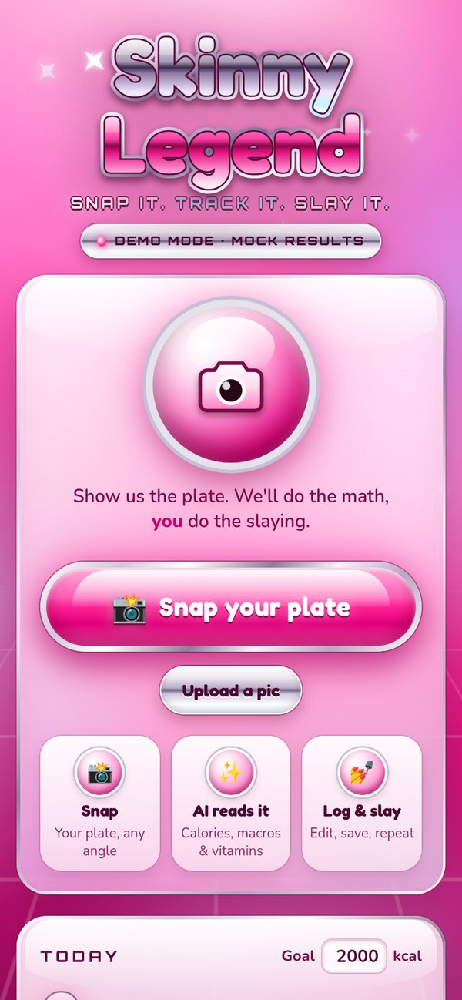
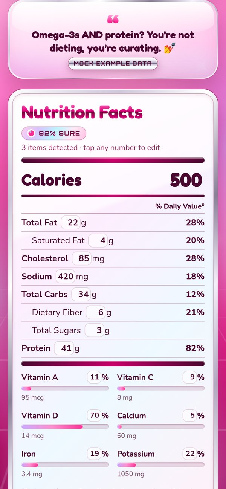
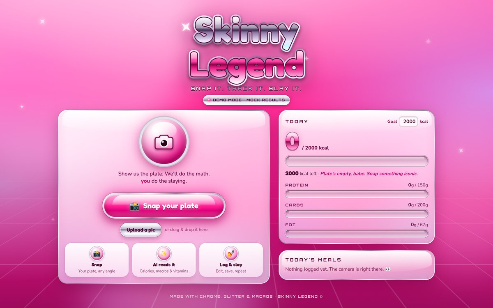

# 💅 Skinny Legend

> Snap your plate. Know your macros. Be Iconic.

### 💖 [Live demo → skinny-legend-eight.vercel.app](https://skinny-legend-eight.vercel.app)

_Open it on your phone and tap **Snap your plate**. It runs in demo mode with mock results until an `XAI_API_KEY` is added in Vercel._

Skinny Legend is a photo-first calorie and nutrition tracker. Take a picture of your food, get an instant estimate of calories, protein, carbs and fat, tweak it if the AI got it wrong, and watch your day add up. No endless database searching, just main-character energy.

This repo has two apps:

- **`web/`**: the website, built with Next.js and deployable to Vercel. Works great on your phone. **Start here.**
- **Root**: the mobile app, built with [Expo](https://expo.dev) (React Native and TypeScript). It runs on iPhone and Android with **Expo Go**.

## 🌐 Website (`web/`)

Hot pink, liquid chrome, Y2K gloss. Snap your plate and get the full nutrition tea.

| Mobile | Result | Desktop |
| ------ | ------ | ------- |
|  |  |  |

**What it does**

- A big glossy **Snap your plate** button opens the camera on phones. On desktop you can upload or drag and drop a photo.
- Photos are resized and compressed in the browser (max 1024px JPEG) before upload.
- `POST /api/analyze` returns the foods it sees with portion estimates, plus totals: calories, protein, carbs, fat, fiber, sugar, sodium, saturated fat and cholesterol. It also returns vitamin A, C, D, calcium, iron and potassium with %DV, a confidence score and a sassy verdict.
- Results show as a chrome **Nutrition Facts** card with a per-food breakdown. Every number is editable before you log.
- The **daily log** shows today's meals with thumbnails, running totals against an editable calorie goal, and macro "gel tube" bars. Meals can be deleted. Everything is stored in `localStorage`.
- **Legend Chat** (`/chat`): ask the Legend things like "what can I eat today at a restaurant near me?". It uses your location (browser GPS, or a city/zip you type), searches Yelp for nearby spots, and recommends a specific order at each one that fits the calories and macros you have left today, with estimated calories/protein and order hacks ("dressing on the side"). Results show as glossy restaurant cards with rating, price, distance, address, photo and a Yelp link, and you can log a pick straight into today. Nutrition here is an **estimate**: Yelp doesn't provide menu nutrition.

**Run it**

```bash
cd web
npm i
npm run dev        # http://localhost:3000
npm run build      # production build
```

**AI analysis and env vars** (server-only, never sent to the browser; see `web/.env.example`)

| Var | Required | Default | What |
| --- | --- | --- | --- |
| `XAI_API_KEY` | for real analysis | none | xAI key. Calls `https://api.x.ai/v1/chat/completions` with the photo as a base64 data URL |
| `NUTRITION_MODEL` | no | `grok-4.7` | Vision-capable Grok model |
| `NUTRITION_REASONING_EFFORT` | no | `low` | xAI reasoning effort (`low`/`medium`/`high`) |
| `OPENAI_API_KEY` | alternative | none | Used only if `XAI_API_KEY` is not set |
| `OPENAI_NUTRITION_MODEL` | no | `gpt-4o-mini` | OpenAI vision model |
| `YELP_API_KEY` | for real restaurants in Legend Chat | none | Yelp Places (Fusion) API key. `/api/chat` calls `GET https://api.yelp.com/v3/businesses/search` server-side |
| `CHAT_MODEL` | no | `NUTRITION_MODEL` | Model for Legend Chat (tool calling + recommendations) |
| `CHAT_REASONING_EFFORT` | no | `low` | xAI reasoning effort for chat |

With **no key**, `/api/analyze` returns clearly labeled **MOCK** example data and the site shows a **Demo mode** badge. In Legend Chat, no `YELP_API_KEY` means clearly labeled **MOCK** restaurants, and no `XAI_API_KEY` means rule-based **MOCK** picks.

**Deploy on Vercel**

Live at **https://skinny-legend-eight.vercel.app** (Vercel project `skinny-legend`).

1. Import `djlamoon/skinny-legend` in Vercel.
2. Set **Root Directory** to `web`. The framework is detected as Next.js.
3. Add `XAI_API_KEY` (and optionally `NUTRITION_MODEL`) under Environment Variables, then deploy.

## 📱 Mobile app (Expo)

### ✨ Features

- **Today screen**: your calories vs. your daily goal, macro progress bars, and a feed of today's meals with photo thumbnails. Long-press a meal to delete it.
- **Snap a meal**: take a photo with the camera or pick one from your library.
- **Analyze**: `analyzeFoodPhoto(uri)` estimates the food name, calories and macros (mocked for now, see below).
- **Confirm and edit**: fix the name, calories, protein, carbs, fat, fiber and sugar before you save. You're the boss.
- **Manual entry**: no photo? Log it by hand.
- **Settings**: set your daily calorie and macro goals.
- **Local-first**: everything is saved on your device with AsyncStorage. No account needed.

### 📸 Screenshots

_Coming soon. Drop images in `docs/screenshots/` and link them here._

| Today | Snap | Confirm |
| ----- | ---- | ------- |
| _TBD_ | _TBD_ | _TBD_ |

### 🚀 Run it

Prereqs: Node 20+ and the **Expo Go** app on your phone.

```bash
npm install
npx expo start
```

Scan the QR code with your phone's camera (iOS) or the Expo Go app (Android). Press `w` to open the web version.

Other handy commands:

```bash
npm run typecheck   # npx tsc --noEmit
npx expo-doctor     # sanity-check dependencies
```

### 🧠 Photo analysis: mock vs. real

All analysis goes through [`src/services/nutrition.ts`](src/services/nutrition.ts):

- `NutritionAnalyzer`: the interface any analyzer implements.
- `MockNutritionAnalyzer`: **MOCK**. It returns example data picked from a small list. The app shows a "MOCK estimate" banner whenever it's used.
- `VisionApiNutritionAnalyzer`: **stub** for a real vision or nutrition API. It reads `EXPO_PUBLIC_NUTRITION_API_KEY` (and optionally `EXPO_PUBLIC_NUTRITION_API_URL`) and has a TODO where the request goes.

To switch, copy `.env.example` to `.env` and set `EXPO_PUBLIC_NUTRITION_PROVIDER=real`. `.env` is git-ignored, so **never commit keys**. Heads-up: `EXPO_PUBLIC_*` values get bundled into the app. In production, call your own backend or proxy that holds the secret.

### 🗂️ Project structure

```
src/
  app/                 # Expo Router screens
    _layout.tsx        # stack navigator + theme
    index.tsx          # Today
    snap.tsx           # camera / library
    confirm.tsx        # analyze + edit + save
    settings.tsx       # goals
  components/          # MacroBar, MealRow
  services/nutrition.ts# analyzer interface, mock, real-API stub
  storage/storage.ts   # AsyncStorage meals + settings
  lib/                 # types, theme, date helpers
```

## 🛣️ Roadmap

- [x] **Real AI photo analysis** on the web (xAI Grok vision via `web/` API route)
- [ ] Real AI photo analysis in the Expo app (call the web `/api/analyze` endpoint)
- [ ] **Barcode scan** for packaged foods
- [ ] **Weekly trends**: charts for calories and macros over time
- [ ] **Streaks**: keep the legend era going 🔥
- [ ] Edit past meals and browse previous days
- [ ] Custom app icon and splash in aqua and cherry

## 📄 License

[MIT](LICENSE) © Skinny Legend contributors
